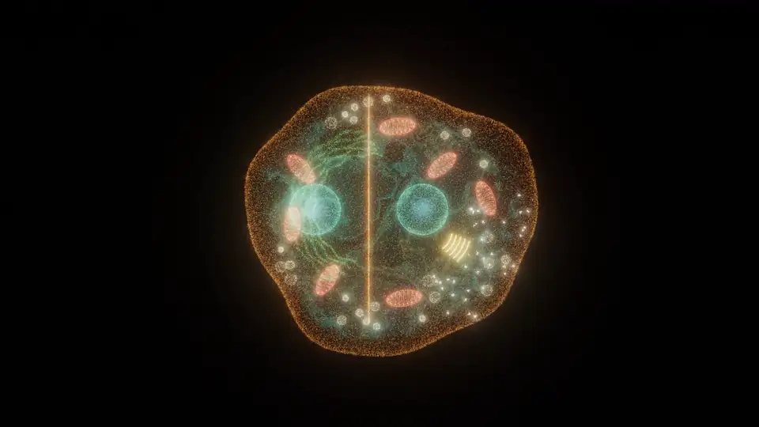
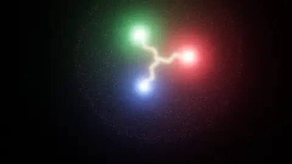
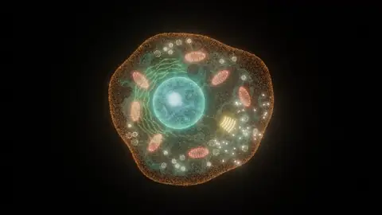
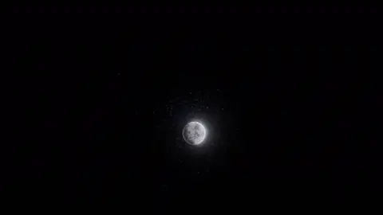
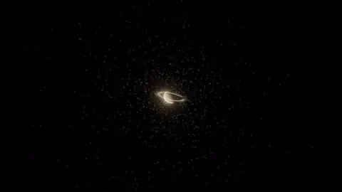
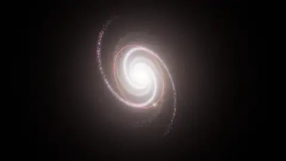
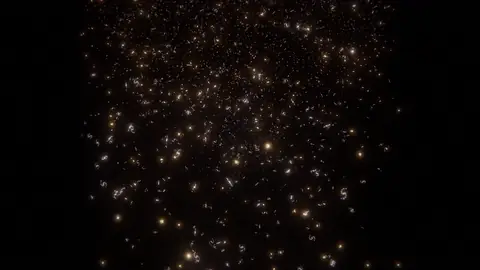

  

  

  

<i>One scroll, sixty orders of magnitude. Every world is built from the particles of the one before.</i>

<table>
  <tr>
    <td width="33%"> <b>10⁻¹⁵ m</b> · A quark pulled until its flux tube snaps</td>
    <td width="33%"> <b>10⁻⁵ m</b> · A plant cell dividing</td>
    <td width="33%"> <b>10⁸ m</b> · Earthrise over the Moon</td>
  </tr>
  <tr>
    <td width="33%"> <b>10⁹ m</b> · Saturn, edge on</td>
    <td width="33%"> <b>10²¹ → 10¹⁵ m</b> · Into the heart of the Milky Way</td>
    <td width="33%"> <b>10²⁶ m</b> · A grain of sand of sky, full of galaxies</td>
  </tr>
</table>

  English · Español &nbsp;—&nbsp; <code>I</code> plates &nbsp;·&nbsp; <code>S</code> sound &nbsp;·&nbsp; <code>A</code> autoplay &nbsp;·&nbsp; <code>L</code> language

How it's made

 

- 31 nested worlds at their real positions, kept in double precision relative to a pivot world, so no raw 10⁶⁰ ever reaches the GPU.
- Everything is particles: worlds are generated in Web Workers and drawn as point clouds, with adaptive resolution to hold the frame rate.
- Real data where it counts: star positions, the S stars' orbits around Sagittarius A*, Saturn's ring profile, Andromeda's direction and distance.
- A plate layer with scientific notes and a scale bar that stays true at every scale. Sound is synthesized in the browser.
- TypeScript, Three.js and Vite, no framework. `npm install`, `npm run dev`; pushing to `main` deploys to GitHub Pages.

After *Powers of Ten*, by Charles and Ray Eames (1977).

