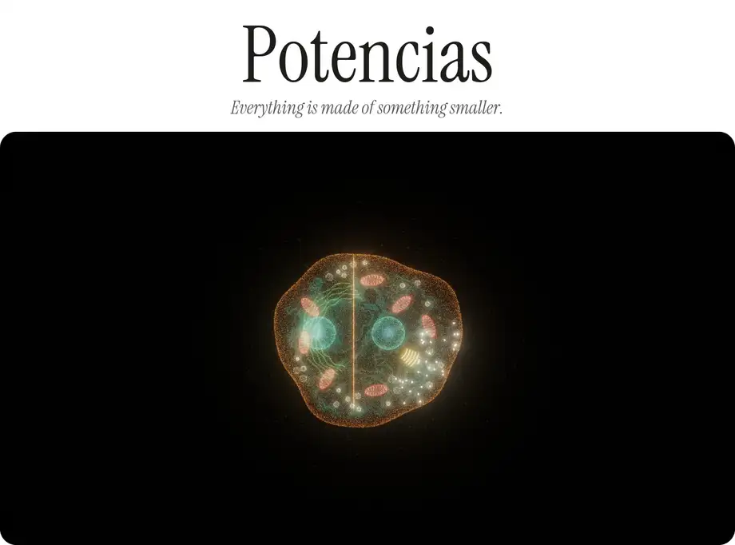
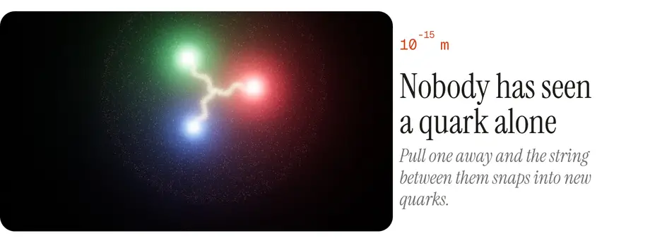
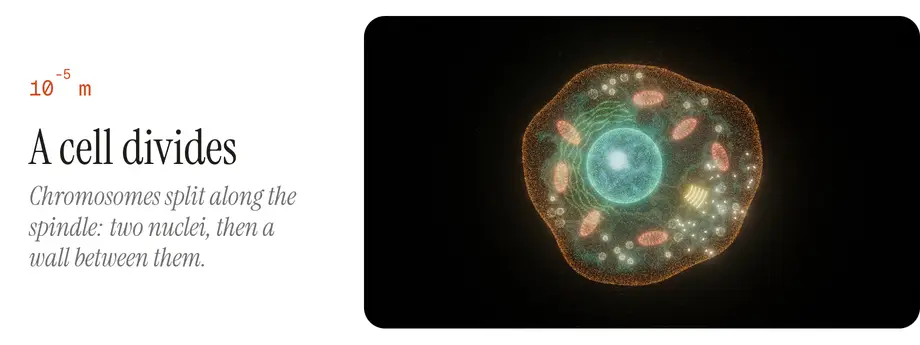
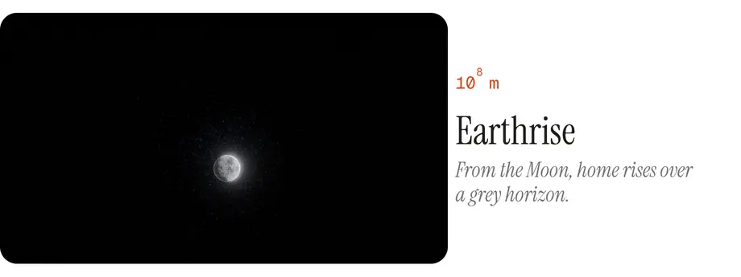
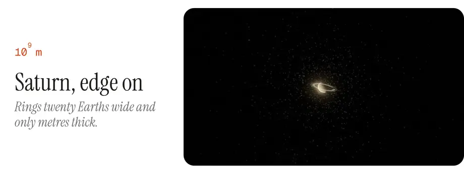
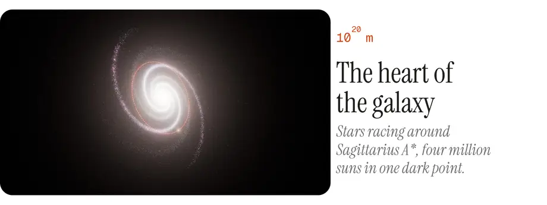
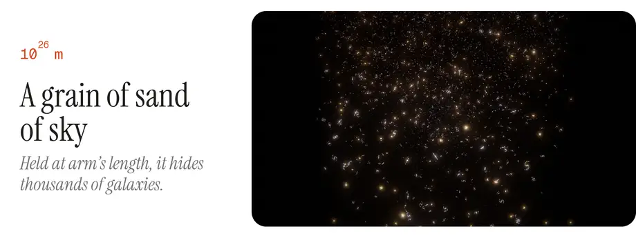

  <a href="https://drayzu.github.io/Potencias/"><picture><source media="(prefers-color-scheme: dark)" type="image/avif" srcset="docs/media/cover-dark.avif"><source media="(prefers-color-scheme: dark)" srcset="docs/media/cover-dark.webp"><source type="image/avif" srcset="docs/media/cover-light.avif"></picture></a>

  <picture><source media="(prefers-color-scheme: dark)" type="image/avif" srcset="docs/media/quark-dark-v4.avif"><source media="(prefers-color-scheme: dark)" srcset="docs/media/quark-dark-v4.webp"><source type="image/avif" srcset="docs/media/quark-light-v4.avif"></picture>

  <picture><source media="(prefers-color-scheme: dark)" type="image/avif" srcset="docs/media/division-dark-v4.avif"><source media="(prefers-color-scheme: dark)" srcset="docs/media/division-dark-v4.webp"><source type="image/avif" srcset="docs/media/division-light-v4.avif"></picture>

  <picture><source media="(prefers-color-scheme: dark)" type="image/avif" srcset="docs/media/earthrise-dark-v4.avif"><source media="(prefers-color-scheme: dark)" srcset="docs/media/earthrise-dark-v4.webp"><source type="image/avif" srcset="docs/media/earthrise-light-v4.avif"></picture>

  <picture><source media="(prefers-color-scheme: dark)" type="image/avif" srcset="docs/media/saturn-dark-v4.avif"><source media="(prefers-color-scheme: dark)" srcset="docs/media/saturn-dark-v4.webp"><source type="image/avif" srcset="docs/media/saturn-light-v4.avif"></picture>

  <picture><source media="(prefers-color-scheme: dark)" type="image/avif" srcset="docs/media/sgr-dark-v4.avif"><source media="(prefers-color-scheme: dark)" srcset="docs/media/sgr-dark-v4.webp"><source type="image/avif" srcset="docs/media/sgr-light-v4.avif"></picture>

  <picture><source media="(prefers-color-scheme: dark)" type="image/avif" srcset="docs/media/deep-dark-v4.avif"><source media="(prefers-color-scheme: dark)" srcset="docs/media/deep-dark-v4.webp"><source type="image/avif" srcset="docs/media/deep-light-v4.avif"></picture>

  <a href="https://drayzu.github.io/Potencias/"><picture><source media="(prefers-color-scheme: dark)" srcset="docs/media/enter-dark.svg"></picture></a>

 

How it's made

 

- 31 nested worlds at their real positions, kept in double precision relative to a pivot world, so no raw 10⁶⁰ ever reaches the GPU.
- Everything is particles: worlds are generated in Web Workers and drawn as point clouds, with adaptive resolution to hold the frame rate.
- Real data where it counts: star positions, the S stars' orbits around Sagittarius A*, Saturn's ring profile, Andromeda's direction and distance.
- A plate layer with scientific notes and a scale bar that stays true at every scale. Sound is synthesized in the browser.
- English and Spanish. Keys: `I` plates, `S` sound, `A` autoplay, `L` language.
- TypeScript, Three.js and Vite, no framework. `npm install`, `npm run dev`; pushing to `main` deploys to GitHub Pages.

After *Powers of Ten*, by Charles and Ray Eames (1977).

